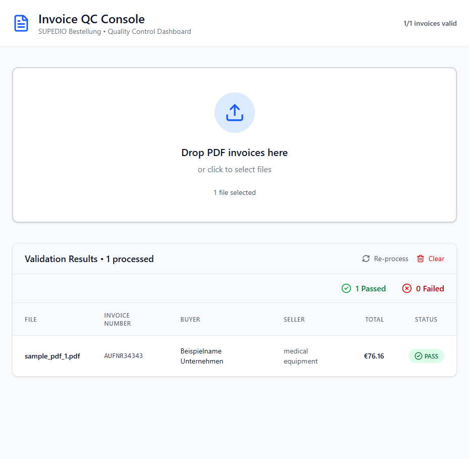

# Invoice QC

Extract, validate and review German B2B invoices from PDFs.

**[Live console](https://invoice-qc.vercel.app/) · [API docs](https://invoice-qc.vercel.app/api/docs) · [Health](https://invoice-qc.vercel.app/health)**



> Demo project. The parser is heuristic and tuned for German `Bestellung` / invoice layouts, not a general document-AI product.

## What it does

Upload one or more PDFs. The service extracts the header fields and line items, validates them against a Pydantic schema plus business rules, and returns a per-invoice pass/fail result with the exact errors. The React console shows the parsed values next to the errors, so a reviewer can see what the machine saw.

```
PDF upload → pdfplumber + German-layout heuristics → Pydantic schema
           → business rules (totals, tax, dates)     → JSON result + review UI
```

**Stack:** Python · FastAPI · Pydantic · pdfplumber · React 19 · Vite · Tailwind · Docker

## API

The deployed API is public under `/api`; the same routes exist unprefixed for local Docker use.

| Method | Path | Purpose |
|---|---|---|
| `GET` | `/health` · `/api/health` | Liveness check |
| `POST` | `/extract-and-validate` · `/api/extract-and-validate` | Multipart upload (`files`); returns totals, validity, errors and the parsed invoices |

Example response (trimmed):

```json
{
  "total": 1,
  "valid": 1,
  "results": [{ "invoice_number": "AUFNR34343", "is_valid": true, "errors": [] }],
  "invoices": [{ "source_file": "vendor_invoice.pdf", "invoice_number": "AUFNR34343", "invoice_date": "2024-05-22", "gross_total": 76.16 }]
}
```

Errors are codes, not prose — `MISSING_INVOICE_DATE`, `NEGATIVE_TOTALS`, `TOTALS_MISMATCH`, `LINES_SUM_MISMATCH`, `DUE_DATE_BEFORE_INVOICE`, `DUPLICATE_INVOICE` — so the console can render them and a caller can branch on them.

## Validation rules

- Required header fields: invoice number, date, seller, buyer, totals.
- `gross_total = net_total + tax_amount` within 0.01.
- Line-item totals must reconcile with `net_total`.
- No negative amounts.
- Due date cannot precede the invoice date.
- Duplicate detection on `(invoice_number, seller, invoice_date)` across the uploaded batch.

## Run it

Requires Docker Desktop.

```bash
docker compose up --build
```

- Console: <http://localhost:5173>
- API docs: <http://localhost:8000/api/docs>

Without Docker:

```bash
python -m venv .venv && source .venv/Scripts/activate   # Windows
pip install -r requirements.txt
uvicorn api.main:app --reload --port 8000

cd frontend && npm install && npm run dev
```

`sample_pdfs/` has five German invoices you can drag in. The Vite dev server proxies `/api` to `localhost:8000`, so the frontend needs no configuration.

## Project layout

```
main.py              FastAPI app (Vercel entrypoint)
api/main.py          re-export for the serverless convention
invoice_qc/          extractor, schema, rules, validator, CLI
frontend/            React console (Vite + Tailwind)
sample_pdfs/         five German invoices for local testing
```

## Deploy

One Vercel project, two services, configured in `vercel.json`:

| Service | Root | Framework | Public path |
|---|---|---|---|
| `api` | `.` | FastAPI | `/api/*` and `/health` |
| `web` | `frontend` | Vite | everything else |

The console calls `/api` on the same origin, so the browser is the caller and no cross-origin setup or service binding is needed. `docker compose` and `Dockerfile.backend` remain the portable path for Render, Railway or Fly.

## Tests

There is no automated suite yet. The five sample PDFs are the current regression set; an automated pytest suite covering extraction and the rules above is the next piece of work.

## Limitations

- First page only; line items continuing onto page two are not handled.
- Heuristics are German-specific (`Bestellung`, comma decimal separators). Other locales will parse poorly.
- No OCR — scanned PDFs need a text layer.
- In-memory processing, no persistence: results are not stored between requests.
